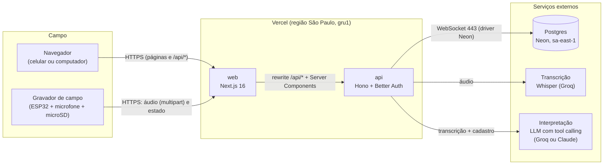
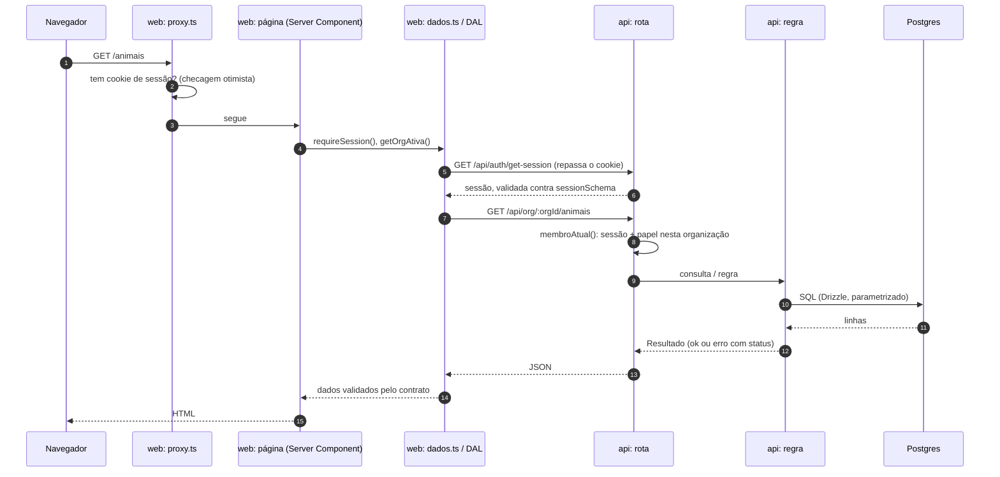
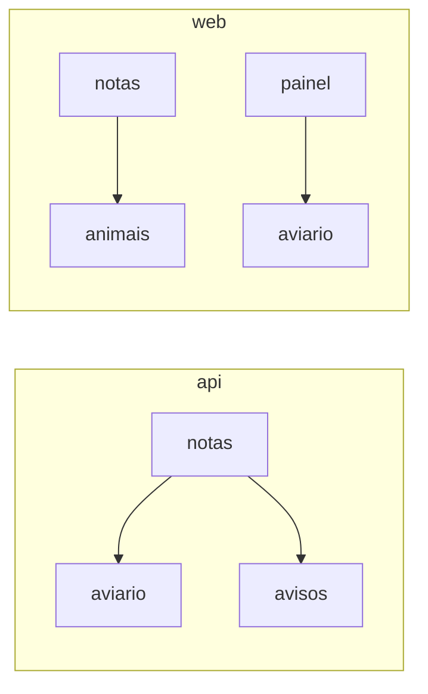
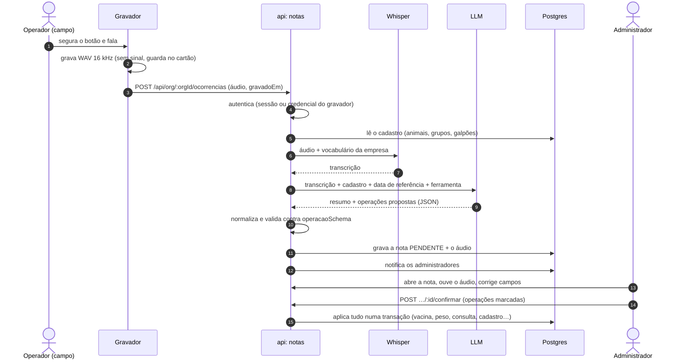

# Arquitetura do software

> Noteless (repositório VOCare): gestão de pecuária e atendimento veterinário
> com registro por voz. Este documento descreve como o sistema está montado,
> os módulos e as principais decisões técnicas, com o porquê de cada uma.
> Estado de referência: `main` em novembro de 2026.

## 1. Visão geral

Quem trabalha no campo não para para digitar. No Noteless, o operador **fala**
o que fez ("vacinei a Mimosa contra aftosa, segunda dose") no gravador de
bolso do Noteless. O áudio é transcrito, uma IA propõe as operações que
aquela fala pede (aplicar vacina, registrar peso, agendar consulta…) e um
administrador **confere e salva**. Só então algo é gravado nas tabelas do
sistema. A IA sugere; quem decide é uma pessoa.



O navegador e o gravador falam **só com o web**. A rota que recebe áudio
aceita o gravador aprovado e também um usuário logado (é por ela que outras
entradas, como o WhatsApp, vão chegar); hoje a tela não tem botão de gravar. Tudo que começa com `/api/*`
é repassado pelo Next para a api (rewrite em `apps/web/next.config.ts`). Com
isso, o cookie de sessão é do mesmo domínio da página e não há CORS no
caminho do usuário.

## 2. Monorepo

```
apps/
  web/        Next.js 16 (App Router) + React 19 — só interface
  api/        Hono 4 + Better Auth + Drizzle ORM — toda a regra de negócio
packages/
  shared/     schemas Zod — o contrato entre web e api
firmware/     código do gravador (ESP32, Arduino) e projeto da placa (KiCad)
docs/         esta documentação, specs e planos
```

- **npm workspaces + Turborepo**: `npm run dev` sobe web (:3000) e api (:4000)
  juntos; `build`, `lint`, `typecheck` e `test` rodam em todos os pacotes,
  com cache.
- **Deploy independente**: web e api são dois projetos na Vercel, a partir do
  mesmo repositório (Root Directory `apps/web` e `apps/api`).
- **Fronteira dura**: o web nunca importa de `apps/api` e vice-versa. O que
  os dois precisam conhecer (formato de um animal, de uma nota, de uma
  operação) mora em `packages/shared` como schema Zod. O mesmo schema valida a
  entrada na api e a resposta que chega no web; se o contrato muda, os dois
  lados quebram na compilação, não em produção.

## 3. Camadas e fluxo de uma requisição



### api (`apps/api`)

| Pasta | Papel |
| --- | --- |
| `src/app.ts` | monta o Hono: log, CORS, `/health`, `/api/auth/*` (Better Auth) e as rotas de cada módulo |
| `src/env.ts`, `src/load-env.ts` | lê e valida as variáveis de ambiente com Zod; falta de variável derruba a subida com a lista exata |
| `src/auth.ts` | configuração do Better Auth (e-mail/senha, organizações, sessão de 30 dias) |
| `src/base/` | o que é comum a todos os módulos: `membroAtual` (sessão + papel), `gravador-atual` (credencial da placa), `super-usuario`, `Resultado`, datas |
| `src/db/` | conexão (driver Neon), `schema.ts` gerado pelo Better Auth, `tabelas/<módulo>.ts` com as tabelas de negócio, seed |
| `src/modulos/<m>/rotas/` | só HTTP: lê parâmetros, valida o corpo com o schema do contrato, chama a regra e traduz o resultado em status |
| `src/modulos/<m>/regras/` | decide e grava; devolve `Resultado` (`{ ok, valor }` ou `{ ok: false, status, erro }`) |
| `src/modulos/<m>/consultas/` | leituras montadas (listas, fichas, relatórios) |
| `drizzle/` | migrações SQL versionadas (0000 a 0016) |
| `test/` | testes de rota contra Postgres em memória (PGlite) |
| `avaliacao/` | conjunto de casos para medir a IA de interpretação |

### web (`apps/web`)

| Pasta | Papel |
| --- | --- |
| `src/proxy.ts` | (o antigo `middleware.ts` do Next) checagem **otimista**: sem cookie, manda para `/login` |
| `src/lib/auth/dal.ts` | checagem **real** da sessão, contra a api, validada pelo contrato |
| `src/app/` | só páginas finas: cada uma chama o `dados.ts` do módulo e entrega para os componentes |
| `src/modulos/<m>/` | `componentes/`, `dados.ts` (busca na api, só no servidor) e `menu.ts` (as telas do módulo no menu lateral) |
| `src/components/ui/` | biblioteca de componentes visuais própria (botão, campo, modal…) |
| `src/app/globals.css` | tokens de cor (Tailwind CSS v4); a cor da marca vive só aqui |

### shared (`packages/shared`)

Um diretório por módulo com os schemas Zod e funções puras que os dois lados
usam (indicadores do aviário, correção de operações, validação de datas).
Tudo é exportado por `@vocare/shared`.

## 4. Módulos

Sete módulos, cada um com pasta nos três pacotes (api, web, shared) e o mesmo
esqueleto. Fora do módulo, só se entra pelo `index.ts` dele. Dois testes
(`apps/api/test/estrutura.test.ts` e `apps/web/src/modulos/estrutura.test.ts`)
barram import que fure essa regra e ciclo entre módulos.

| Módulo | O que faz | Telas |
| --- | --- | --- |
| **conta** | usuários e papéis por organização, perfil, super usuário (vínculos entre usuários e empresas), gravadores de campo (aprovação) | Configurações › Usuários, Vínculos, Gravadores; Perfil |
| **notas** | o coração do produto: recebe o áudio, transcreve, interpreta com IA, guarda como pendente; conferência, encaminhamento e aplicação das operações | Notas |
| **animais** | cadastro, grupos (lote, baia, ninhada), ficha com o histórico (pesagens, vacinas, tratamentos, partos, anotações) | Animais › Cadastro, Grupos, ficha do animal |
| **saude** | agenda de consultas e prontuários de atendimento | Saúde › Agenda, Prontuários |
| **aviario** | galpões, lotes de aves, alojamentos, apontamento diário (mortalidade, ovos, ração, água), pesagem e vacinação de lote | Aviário › Lotes, Galpões |
| **avisos** | notificações por usuário e o sinal de "novidade" da tela ao vivo | sino do cabeçalho |
| **painel** | só lê os outros: avisos do dia e relatórios | Início, Relatórios |

Dependências de código entre módulos (sem ciclo; conferido no `main`):



As tabelas ficam em `apps/api/src/db/tabelas/<módulo>.ts` e são lidas por
quem precisa (o painel lê as de todos para montar o Início e os relatórios; a
confirmação de uma nota grava nas de animais, saúde e aviário dentro de uma
transação). O que um módulo expõe para outro em código passa pelo `index.ts`.

## 5. Fluxo principal: do áudio à nota salva



Pontos de projeto:

- **Nada é gravado sem um humano confirmar.** As operações propostas ficam em
  JSON na nota; só a confirmação transforma em linhas nas tabelas, e numa
  transação (ou entra tudo, ou nada).
- **Membro confere, administrador salva.** O membro usa "Mandar para o
  administrador"; salvar ou descartar é de `owner`/`admin`.
- **Falta de sinal não perde gravação.** O gravador guarda no microSD e envia
  depois, com a hora em que gravou (`gravadoEm`). Essa hora vira a data da
  nota e o "hoje" da IA ("nasceu hoje", enviado amanhã, é de ontem).
- **Áudio que a IA não entende vira nota mesmo assim**: quem confere escreve
  o que foi dito e a IA reinterpreta (`POST …/:id/texto`).

Detalhes da IA em [ia.md](ia.md).

## 6. Gravador de campo

Placa ESP32 com microfone e cartão microSD (código em `firmware/gravador`,
placa própria em projeto em `firmware/placa`).

- Segura o botão, fala, solta: grava até 2 min em WAV 16 kHz (o limite vem
  dos 4,5 MB por requisição da Vercel). Desde 18/11 o áudio sai em μ-law
  (G.711, 1 byte por amostra): metade do tamanho do PCM de 16 bits, com a
  mesma faixa útil para a fala, o que faz a gravação subir mesmo com Wi-Fi
  fraco. A api converte para PCM de 16 bits antes da transcrição
  (`regras/wav.ts`); o que chega do firmware antigo passa como veio.
- A gravação entra numa fila no cartão; com Wi-Fi, sobe da mais antiga para a
  mais nova. O arquivo só é apagado depois que o servidor confirma. Gravação
  que falha 3 vezes seguidas sai da frente por 15 min, para não segurar as
  outras.
- O Wi-Fi pode ser desligado pela serial (`wifi off`): as gravações ficam no
  cartão até ele voltar. O super usuário também pode **pausar os envios** de
  uma placa em Configurações › Gravadores; ela continua avisando o estado.
- O Wi-Fi é escolhido pelo usuário num portal de configuração que a placa abre
  (rede "Noteless-XXXX"), não fica no código.
- **A placa não tem conta nem senha.** Na primeira vez que liga, sorteia um
  segredo de 32 bytes e guarda na flash. Toda chamada leva
  `Authorization: Gravador <série> <segredo>`; o servidor guarda só o SHA-256
  do segredo. A placa aparece "aguardando aprovação" e o super usuário a aprova
  digitando o código de 6 letras que ela mostra (derivado do segredo) e
  escolhendo a empresa. A placa só consegue mandar áudio para essa empresa.
- A cada 15 min ela avisa o estado (Wi-Fi, cartão, fila, erros), que aparece
  em Configurações › Gravadores.
- **Atualização pelo ar (OTA).** O super usuário publica o `.bin` em
  Configurações › Gravadores › Firmware e escolhe quais placas atualizam. A
  api assina cada versão com ECDSA P-256 (`FIRMWARE_CHAVE_PRIVADA`); a placa,
  parada, baixa em pedaços de 32 KB (se o Wi-Fi cair, continua de onde
  parou), confere o SHA-256 e a assinatura com a chave pública embutida e
  instala na outra metade da flash. A versão nova só fica depois do primeiro
  aviso aceito: se travar, ou passar 10 min com Wi-Fi sem avisar, a placa
  volta sozinha para a anterior.

## 7. Tela ao vivo

Nota que chega do gravador aparece sem recarregar a página. Com a aba
visível, o web pergunta `GET /api/org/:orgId/novidades` a cada 5 s (30 s se
ninguém mexe há 3 min; nada com a aba escondida). A resposta é uma versão
opaca; se mudou, `router.refresh()` busca a página de novo.

## 8. Principais decisões técnicas

| # | Decisão | Por quê | Custo aceito |
| --- | --- | --- | --- |
| 1 | **Front e back separados**, deploy independente | regra de negócio num lugar só; o gravador e futuras integrações (WhatsApp) chamam a mesma api que a tela | dois projetos para configurar |
| 2 | **Navegador só fala com o web** (rewrite de `/api/*`) | cookie de sessão same-origin, sem CORS, sem expor a api ao usuário | um salto a mais por requisição |
| 3 | **Contrato em Zod** no `packages/shared` | um schema valida os dois lados; mudança quebra na compilação | disciplina de passar tudo por lá |
| 4 | **Hono** na api | leve, roda igual em Node e na Vercel, tipado | ecossistema menor que Express |
| 5 | **Next.js 16 (App Router)** no web | Server Components buscam dados no servidor (o cookie nunca vai para JavaScript do cliente); rotas tipadas | versão nova, com mudanças incompatíveis |
| 6 | **Better Auth** com plugin de organizações | e-mail/senha, sessão em banco e multiempresa (organização, membro, papel) prontos e auditados pela comunidade | dependência de terceiro no ponto mais sensível |
| 7 | **Postgres (Neon) + Drizzle** | relacional com integridade referencial, JSONB para o que é sugestão da IA, migrações versionadas; ver [modelo-de-dados.md](modelo-de-dados.md) | — |
| 8 | **Driver do Neon por WebSocket na 443** | a 5432 é bloqueada na rede da faculdade; assim roda em qualquer rede | só conecta em Neon (ou Postgres atrás de proxy WebSocket) |
| 9 | **IA propõe, humano confirma** | erro de transcrição ou de interpretação não vira dado errado no rebanho | um passo de conferência |
| 10 | **Provedor de IA trocável por variável** | começa grátis (Groq) e troca para Claude sem mudar código | duas integrações para manter |
| 11 | **Polling em vez de WebSocket/SSE** na tela ao vivo | a Vercel não segura WebSocket, e SSE deixaria uma função aberta (memória cobrada) o tempo todo | até 5 s de atraso |
| 12 | **Gravador sem conta**, com segredo próprio e aprovação por código | não há senha para vazar no firmware; só a placa física mostra o código certo | o super usuário aprova cada placa |
| 13 | **Áudio no banco** (`bytea`, tabela separada) | áudio de nota é curto; uma infraestrutura a menos | se o volume crescer, migrar para storage de arquivos |
| 14 | **Organização por módulo** com teste de estrutura | cada assunto num lugar; o teste impede import cruzado e ciclo | — |
| 15 | **Toda funcionalidade com teste no mesmo commit**; CI no GitHub Actions | regressão aparece antes do deploy | tempo de escrever teste |

## 9. Onde aprofundar

- Modelo de dados e justificativa do banco: [modelo-de-dados.md](modelo-de-dados.md)
- Segurança (autenticação, autorização, vulnerabilidades): [seguranca.md](seguranca.md)
- LGPD: [lgpd.md](lgpd.md)
- Uso de IA: [ia.md](ia.md)
- Infraestrutura, dependências e ambientes: [infraestrutura.md](infraestrutura.md)
- Decisões de cada funcionalidade grande: `docs/superpowers/specs/` (o que e
  por quê) e `docs/superpowers/plans/` (como foi feito)
