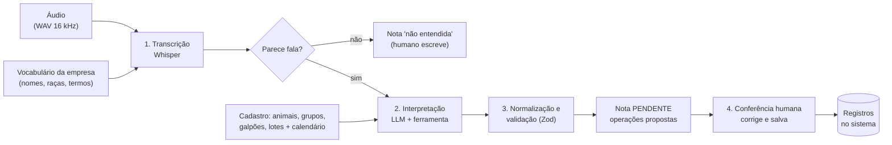

# Uso de inteligência artificial

O Noteless usa IA em dois lugares: **no produto**, para transformar a fala
do campo em registros; e **no desenvolvimento**, como assistente de
programação. Este documento descreve os dois e justifica o valor de cada um.

## 1. IA no produto

### 1.1 O problema

Quem cuida de animais está de luva, com a mão suja, no meio do curral ou do
galpão. Parar para digitar num formulário ("animal", "vacina", "dose",
"data", "próxima dose") é o motivo de o registro ficar para depois e se
perder. Falar leva segundos: "vacinei a Mimosa e a Estrela contra aftosa,
segunda dose, a próxima é daqui a seis meses".

A IA faz a ponte entre a fala livre e o dado estruturado que o sistema
precisa.

### 1.2 O pipeline

**1. Transcrição** (`apps/api/src/modulos/notas/ia/transcrever.ts`)

- Modelo Whisper pela API compatível com a OpenAI; em produção,
  `whisper-large-v3` na Groq.
- Português forçado e temperatura 0.
- **Vocabulário da empresa no prompt** (`vocabulario.ts`): nomes dos animais,
  grupos, galpões e lotes, raças e termos de manejo das espécies que a empresa
  cria. Assim "landraste" sai "landrace" e "Mimoza" sai "Mimosa".
- **Filtro de alucinação**: Whisper inventa frases em áudio sem fala
  ("Obrigado.", "Legendas pela comunidade Amara.org", ou um pedaço do próprio
  prompt). Isso vira "não entendido", nunca uma nota com texto inventado.

**2. Interpretação** (`analisar.ts`, `instrucoes.ts`, `ferramenta.ts`)

- Modelo de linguagem com **tool calling forçado**: o modelo é obrigado a
  responder chamando uma ferramenta cujo esquema descreve as operações
  possíveis. A saída é JSON, não texto livre.
- Recebe a transcrição, o cadastro da empresa (com ids), a data de
  referência e um **calendário** com os dias da semana ao redor ("sexta que
  vem" numa terça virava quarta antes do calendário).
- Devolve um resumo, as **operações propostas**, cada uma com uma confiança
  de 0 a 100, e a transcrição com palavras mal ouvidas corrigidas.
- **Provedor trocável** por variável de ambiente (`provedor.ts`): com só
  `GROQ_API_KEY` (grátis), roda `openai/gpt-oss-120b` na Groq; com
  `ANTHROPIC_API_KEY`, passa para o Claude. Resposta fora do formato ganha uma
  segunda tentativa.

Operações que a IA sabe propor:

| Animais e saúde | Aviário |
| --- | --- |
| agendar consulta | apontar o dia do galpão (mortes, ovos, ração, água) |
| registrar anotação | pesar lote |
| registrar peso | vacinar lote |
| aplicar vacina (animal ou grupo) | |
| registrar remédio/tratamento | |
| registrar parto (e cadastrar as crias) | |
| cadastrar animal | |

**3. Normalização e validação** (`normalizar.ts`, `correcao.ts`)

- Tudo que o modelo devolve passa pelo schema Zod do contrato
  (`operacaoSchema`). O que não bate é descartado.
- Id que não existe no cadastro da empresa é descartado: a operação fica
  sem animal, com confiança de no máximo 60, e só é aplicável depois que
  quem confere escolhe o animal.
- Nome de animal que é só descrição ("porco novo", "um landrace") não vira
  nome: fica vazio, com confiança baixa, para quem confere escrever.
- A correção da transcrição só vale se **nenhum número mudou** e se mudou
  **no máximo 30%** do texto. O que o Whisper ouviu fica guardado
  (`transcricao_original`).

**4. Conferência humana**

A IA **nunca grava** no sistema. A nota fica pendente; quem confere ouve o
áudio, lê a transcrição, corrige campos, desmarca o que não quer e salva. Só
o administrador salva; o membro encaminha. A confirmação aplica as
operações numa transação.

### 1.3 Como a qualidade é medida

- **Conjunto de avaliação** (`apps/api/avaliacao/`): 41 casos com
  transcrições como chegam do campo (erro de transcrição, apelido, data
  relativa, fala corrigida no meio, notas reais de uma granja parceira) e o que
  um revisor humano diria que cada uma pede. `npm run avaliar -w @vocare/api`
  roda contra a IA configurada e mede acerto por tipo de operação,
  operações faltando, operações inventadas, campos certos e se a confiança
  informada pelo modelo corresponde ao acerto.
- **Resultado (15/11/2026)**: 38 de 41 casos perfeitos com
  `openai/gpt-oss-120b` (antes das melhorias de vocabulário e calendário: 26
  de 30).
- **Testes automatizados** (`test/notas/ia.test.ts`, `analisar-aviario.test.ts`,
  `avaliar.test.ts`) cobrem normalização, filtro de alucinação, correção e a
  pontuação da avaliação, sem chamar a IA de verdade.

### 1.4 Justificativa de valor

| Sem IA | Com IA |
| --- | --- |
| formulário por evento, preenchido depois, no escritório | fala no momento, com a mão ocupada |
| registro esquecido ou com data errada | a hora da gravação vira a data do registro, mesmo enviado depois |
| uma tela por tipo de evento | uma fala pode gerar várias operações (vacina + peso + consulta) |
| quem não lê/escreve bem fica de fora | basta falar |

- **Custo**: a Groq grátis cobre cerca de 65 notas por dia (limite de 200 mil
  tokens/dia do modelo; cada nota gasta uns 3 mil). Acima disso, a troca para
  um provedor pago é só de variável de ambiente.
- **Risco controlado**: erro de transcrição ou de interpretação não vira dado
  errado, porque nada entra sem conferência humana; a confiança baixa
  sinaliza o que olhar com mais cuidado.
- **Privacidade**: o áudio vai para a Groq (EUA) e é tratado como
  transferência internacional; ver [lgpd.md](lgpd.md).

## 2. IA no desenvolvimento

### 2.1 Como foi usada

O time usou o **Claude Code** (Anthropic) como assistente de programação,
com regras do projeto escritas para ele:

- `CLAUDE.md` (raiz) e `apps/web/AGENTS.md`: arquitetura, convenções e
  regras que o assistente segue (estrutura por módulo, fronteira entre web e
  api, nome dos arquivos, "toda funcionalidade nova vem com teste no mesmo
  commit").
- Funcionalidades grandes seguem **especificação → plano → implementação**,
  com os documentos versionados em `docs/superpowers/specs/` e
  `docs/superpowers/plans/` (modularização, módulos na tela, aviário de
  matrizes, super usuário).
- Os commits feitos com o assistente levam a linha
  `Co-Authored-By: Claude …` (113 dos 135 commits até 16/11/2026), o que deixa
  rastreável no histórico o que teve participação da IA.

### 2.2 Controles

A IA no desenvolvimento acelera, mas não decide sozinha:

- quem pede, revisa e aprova cada mudança é uma pessoa do time;
- todo código passa por `lint`, `typecheck`, 316 testes e `build`, no local e
  no CI (GitHub Actions) a cada push;
- testes de estrutura barram import errado entre módulos, independentemente
  de quem escreveu;
- segredos nunca vão para o assistente nem para o repositório.

### 2.3 Valor

- Velocidade: o MVP com 7 módulos, gravador físico e IA no produto foi
  construído por um time pequeno em cerca de dois meses.
- Qualidade: a regra de teste obrigatório, aplicada também pelo assistente,
  levou a 316 testes automatizados.
- Documentação viva: especificações, planos e este próprio conjunto de
  documentos foram produzidos com apoio da IA e revisados pelo time.
