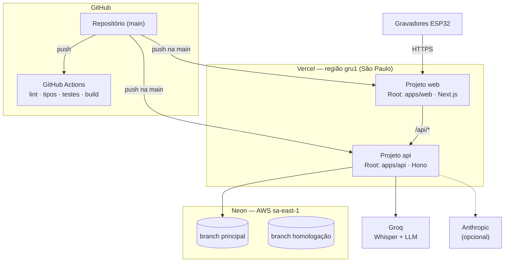

# Infraestrutura, dependências e ambientes

## 1. Visão geral

| Componente | Serviço | Plano | Para quê |
| --- | --- | --- | --- |
| Front (web) | Vercel, projeto com Root Directory `apps/web` | grátis | páginas e repasse de `/api/*` |
| Back (api) | Vercel, projeto com Root Directory `apps/api` | grátis | regra de negócio, autenticação, IA |
| Banco | Neon (Postgres serverless), `sa-east-1` | Free | dados; branches principal e homologação |
| Transcrição e interpretação | Groq | Free (≈ 65 notas/dia) | Whisper e `openai/gpt-oss-120b` |
| Interpretação alternativa | Anthropic | pago, opcional | Claude, se `ANTHROPIC_API_KEY` existir |
| Código e CI | GitHub (privado) + GitHub Actions | Free | versionamento, verificação a cada push |
| Gravador de campo | ESP32 + microfone + microSD | hardware próprio | captura de áudio em campo |

Custo mensal de infraestrutura: **zero** enquanto os serviços ficarem nos
planos grátis (conferir no painel de cada um se algum plano mudou).

## 2. Deploy

- **Automático**: push na `main` publica os dois projetos na Vercel.
  **Atenção:** migração de banco não roda no deploy. Se o commit traz
  migração nova, aplique antes (`npm run db:migrate`), senão a api quebra ao
  ler a coluna que ainda não existe.
- **api**: o build roda `tsup` e gera um único `dist/index.js` (com o
  `@vocare/shared` dentro). A entrada da Vercel é `apps/api/server.js`, que
  reexporta esse arquivo.
- **web**: `next build`. `API_URL` precisa existir no projeto antes do build
  (sem ela o build para com uma mensagem).
- Nos dois projetos, Settings → Functions → região **São Paulo (gru1)**, a
  mesma do banco.
- Primeira vez: crie a api, crie o web com a URL dela, volte na api para pôr a
  URL do web (`WEB_URL`, `BETTER_AUTH_URL`) e faça Redeploy.

## 3. Ambientes

| Ambiente | Como sobe | Banco | Uso |
| --- | --- | --- | --- |
| Local | `npm run dev` (web :3000, api :4000) | Neon, branch principal | desenvolvimento do time |
| Local contra homologação | `npm run dev:hom` | Neon, branch homologação (`.env.hom`) | testar migração e dados de teste |
| Testes | `npm test` | PGlite (Postgres em memória) | sem rede, sem chave, sem `.env` |
| CI | GitHub Actions a cada push e PR | nenhum | lint, tipos, testes e build |
| **Produção / demonstração** | Vercel | Neon, branch principal | **https://vocare-iota.vercel.app** |

A api imprime na subida qual arquivo de ambiente carregou e o host do banco.
Se `.env.hom` não existir, `dev:hom` se recusa a subir: nunca cai no banco
principal por engano.

## 4. Variáveis de ambiente

### api (`apps/api/.env`, ou variáveis do projeto na Vercel)

| Variável | Obrigatória | O que é |
| --- | :-: | --- |
| `DATABASE_URL` | sim | connection string do Neon (com `sslmode=require`) |
| `BETTER_AUTH_SECRET` | sim | segredo das sessões, ≥ 32 caracteres (`openssl rand -base64 32`); o mesmo para todo o time |
| `BETTER_AUTH_URL` | sim | URL pública por onde o navegador chega na api. Na Vercel, **a URL do web** |
| `WEB_URL` | sim | origem do front; login de outra origem é recusado |
| `ORIGENS_EXTRAS` | não | outras origens permitidas, separadas por vírgula |
| `PORT` | não | padrão 4000 (só local) |
| `GROQ_API_KEY` | para a IA | chave grátis em console.groq.com; sem ela, gravar responde 503 explicando |
| `ANTHROPIC_API_KEY` | não | interpretação pelo Claude |
| `IA_MODELO` | não | troca o modelo de interpretação |
| `TRANSCRICAO_API_KEY`, `TRANSCRICAO_BASE_URL`, `TRANSCRICAO_MODELO` | não | outro serviço de transcrição; em produção, `TRANSCRICAO_MODELO=whisper-large-v3` |

A api valida tudo na subida (`src/env.ts`) e, se faltar algo, para com a
lista exata.

### web (`apps/web/.env.local`, ou variáveis do projeto na Vercel)

| Variável | Obrigatória | O que é |
| --- | :-: | --- |
| `API_URL` | sim na Vercel | URL da api; usada só no servidor do Next (rewrites e DAL), nunca vai ao navegador |

### firmware (`firmware/gravador/segredos.h`, fora do git)

| Constante | O que é |
| --- | --- |
| `SERVIDOR_URL` | URL do web publicado (ou o IP do notebook com `npm run dev:hom`) |

O Wi-Fi é escolhido no portal da placa; a placa não tem conta nem senha.

## 5. Dependências e versões

Versões instaladas pelo `package-lock.json` em 16/11/2026.

### Plataforma

| Item | Versão |
| --- | --- |
| Node.js | ≥ 24 (testado com 24.15.0) |
| npm | 11.12.1 (`packageManager`) |
| TypeScript | 5.9.3 |
| Turborepo | 2.10.13 |
| PostgreSQL | gerenciado pelo Neon |

### api

| Pacote | Versão | Uso |
| --- | --- | --- |
| hono | 4.13.19 | servidor HTTP |
| @hono/node-server | 1.19.19 | rodar o Hono no Node (local) |
| better-auth | 1.7.15 | autenticação e organizações |
| drizzle-orm | 0.45.2 | ORM |
| @neondatabase/serverless | 1.1.0 | driver do Postgres por WebSocket |
| zod | 4.6.7 | validação |
| drizzle-kit | 0.31.11 | migrações (dev) |
| tsup | 8.5.1 | build (dev) |
| tsx | 4 | rodar TypeScript em dev |
| @electric-sql/pglite | 0.5.8 | Postgres em memória nos testes (dev) |
| vitest | 5.1.0 | testes (dev) |

### web

| Pacote | Versão | Uso |
| --- | --- | --- |
| next | 16.4.6 | framework (App Router) |
| react / react-dom | 19.2.8 | interface |
| better-auth | 1.7.15 | cliente de autenticação |
| zod | 4.6.7 | validação do contrato |
| lucide-react | 1.46.0 | ícones |
| tailwindcss | 4.3.3 | estilo (dev) |
| eslint + eslint-config-next | 9 / 16.4.6 | lint (dev) |
| vitest | 5.1.0 | testes (dev) |

### shared

| Pacote | Versão |
| --- | --- |
| zod | 4.6.7 |

### firmware

| Item | Versão |
| --- | --- |
| arduino-cli + core `esp32:esp32` | core 3.3.12 |
| Placa de desenvolvimento | ESP32 DevKit (ESP32-D0WD-V3), microfone I2S INMP441, módulo microSD |
| Placa própria (em projeto) | ESP32-S3-MINI-1, microfone PDM, KiCad 10 (`firmware/placa/`) |

Versões depois da atualização de segurança de 16/11/2026 (V1 em
[seguranca.md](seguranca.md)). O `npm audit` ainda aponta 5 alertas
moderados, nenhum alcançável em produção; a explicação está lá.

## 6. Ambiente de demonstração para a banca

- **Endereço**: https://vocare-iota.vercel.app (no ar em 16/11/2026;
  `/health` responde `{"ok":true}`).
- **Acesso**: não há cadastro público. Para a banca:
  1. Criar uma empresa de demonstração no banco principal:
     `npm run seed -- "Fazenda Demonstração" banca@<domínio> "<senha forte>"`.
  2. Cadastrar alguns animais, um grupo e um galpão com lote. Aprovar um
     gravador para a empresa de demonstração (Configurações › Gravadores) e
     gravar duas ou três notas com ele, para a banca já encontrar notas
     salvas e uma pendente.
  3. Passar e-mail e senha à banca por canal privado, nunca no repositório.
  4. Depois da avaliação, trocar a senha ou remover a conta.
- **Roteiro sugerido** (5 min): login → Início → falar no gravador "pesei a
  Mimosa, 420 quilos, e vacinei contra aftosa" → a nota chega sozinha em
  Notas (tela ao vivo) → ouvir o áudio e ver as operações propostas → salvar
  → abrir a ficha do animal e ver o peso e a vacina → Relatórios.
- **Sem internet ou sem cota da IA**: o resto do sistema funciona; gravar
  responde com a mensagem do motivo. Ter um vídeo curto do fluxo de voz como
  reserva.

## 7. Operação

| Tarefa | Como |
| --- | --- |
| Aplicar migrações | `npm run db:migrate` (principal) / `npm run db:migrate:hom` |
| Criar empresa + primeiro usuário | `npm run seed -- "<empresa>" <email> <senha>` |
| Promover super usuário | `npm run super -w @vocare/api -- <email>` |
| Ver o banco | `npm run db:studio` (Drizzle Studio) |
| Medir a IA | `npm run avaliar -w @vocare/api` (gasta cota; no máximo uma vez por dia) |
| Logs | painel da Vercel, projeto da api → Logs |
| Estado dos gravadores | Configurações › Gravadores (super usuário) |
| Backup | Neon guarda histórico para restauração (point-in-time) conforme o plano; antes de migração destrutiva, criar um branch do principal |
