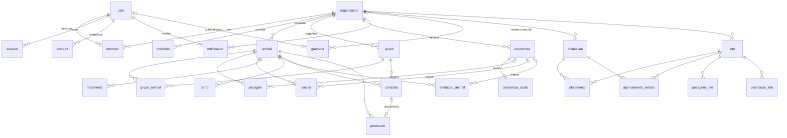
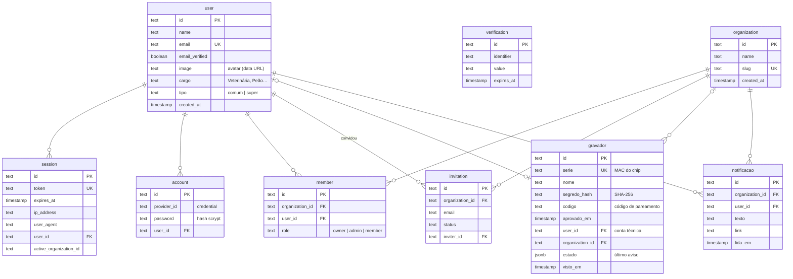
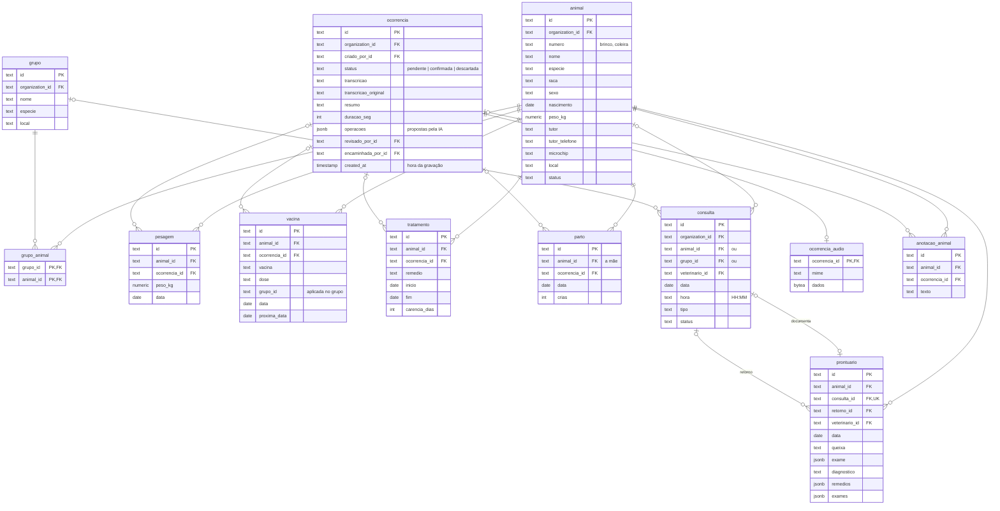
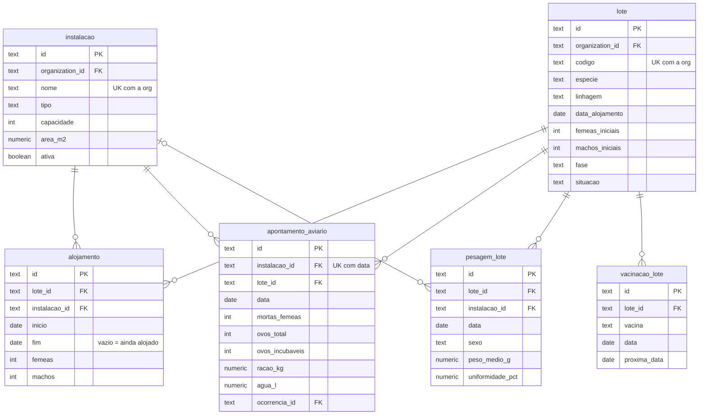

# Modelo de dados

> Banco: PostgreSQL no Neon, acessado pelo Drizzle ORM. Fonte da verdade:
> `apps/api/src/db/schema.ts` (tabelas do Better Auth, geradas) e
> `apps/api/src/db/tabelas/<módulo>.ts` (tabelas de negócio). As migrações
> SQL estão em `apps/api/drizzle/` (0000 a 0015 na `main`).

## 1. Escolha do banco de dados

**PostgreSQL**, hospedado no **Neon**, com **Drizzle ORM**.

### Por que relacional

Os dados do Noteless são relacionais por natureza: uma organização tem
animais; um animal tem pesagens, vacinas, tratamentos, partos, consultas e
prontuários; um lote de aves ocupa galpões ao longo do tempo. O banco precisa
garantir isso, não o código:

- **Integridade referencial**: chave estrangeira em todo vínculo. Uma vacina
  não existe sem o animal; apagar a organização apaga tudo dela (`cascade`);
  um usuário que sai deixa o histórico sem autor em vez de sumir com ele
  (`set null`).
- **Transações**: salvar uma nota aplica várias operações em tabelas
  diferentes (vacina, peso, consulta, cadastro de crias). Ou entra tudo, ou
  nada. Isso é natural em Postgres e difícil em bancos de documentos.
- **Restrições de unicidade** que são regra de negócio: um apontamento por
  galpão por dia; código de lote único na empresa; um prontuário por
  consulta.
- **JSONB para o que não é dado do sistema ainda**: as operações que a IA
  propõe são uma sugestão com forma variável por tipo. Ficam em JSONB na
  nota, validadas pelo contrato Zod na leitura, e só viram linhas de verdade
  na confirmação. O mesmo para o estado que o gravador reporta e para as
  listas curtas do prontuário (exame físico, remédios, exames pedidos).
- **Consultas de relatório** (vacinas a vencer, animais em carência,
  indicadores de postura) são `JOIN` + filtro por data, o forte de SQL.

### Por que Neon

- Postgres gerenciado e **serverless**: escala a zero, plano grátis suficiente
  para o MVP.
- **Branches**: o banco principal e o de homologação são branches do mesmo
  projeto. Migração arriscada é testada no de homologação antes
  (`npm run db:migrate:hom`).
- **Driver por WebSocket na porta 443**: a rede da faculdade bloqueia a 5432.
  Com `@neondatabase/serverless`, a api e as migrações funcionam em qualquer
  rede, sem VPN.
- Região `sa-east-1` (São Paulo), a mesma das funções da Vercel (`gru1`):
  menor latência e dados no Brasil.

### Por que Drizzle

- O esquema é código TypeScript: o tipo de cada linha chega pronto nas
  regras, e erro de coluna aparece na compilação.
- Gera **migrações SQL versionadas** no git (`npm run db:generate`), revisáveis
  em diff.
- Consultas parametrizadas por padrão (proteção contra SQL injection).
- Funciona igual com o **PGlite** (Postgres compilado para WebAssembly): os
  testes de rota rodam contra um Postgres de verdade, em memória, com as
  mesmas migrações.

### Alternativas consideradas

| Alternativa | Por que não |
| --- | --- |
| MongoDB / Firestore | dados relacionais; sem chave estrangeira; transação entre coleções é mais cara e menos natural; regras de acesso viram código espalhado |
| MySQL | atenderia, mas JSONB do Postgres é mais completo e o Neon (branches, WebSocket) só existe para Postgres |
| SQLite / Turso | ótimo para um processo só; com várias funções serverless e o time inteiro no mesmo banco, Postgres é mais simples de operar |
| Supabase | também Postgres; o Neon foi escolhido pelo driver WebSocket e pelos branches; a autenticação já é do Better Auth |

## 2. Convenções

- **Chave primária** `id text`, gerada como UUID v4 (`crypto.randomUUID()`) nas
  tabelas de negócio; o Better Auth gera os ids das tabelas dele. Ids não são
  sequenciais: não dá para adivinhar o próximo.
- **Multiempresa**: toda tabela de negócio tem `organization_id` (FK para
  `organization`, `on delete cascade`). Toda consulta da api filtra por ele.
- **Valores fechados** (espécie, status, tipo de consulta, fase do lote) são
  `text` validados pelo contrato Zod, não `enum` do Postgres: incluir um
  valor novo não exige migração.
- **Datas**: `date` para o que é dia de calendário (vacina, parto, consulta);
  `hora` da agenda é texto "HH:MM" "de parede" (08:00 é 08:00 na fazenda,
  sempre); `timestamp` (sem fuso, gravado em UTC) para momentos (criação,
  revisão).
- **Autoria**: `criado_por_id`, `revisado_por_id`, `encaminhada_por_id` e
  afins apontam para `user` com `on delete set null`.
- **Origem**: eventos que nasceram de uma nota guardam `ocorrencia_id`
  (`set null`), para saber de qual áudio veio cada registro.
- **Esquema do Better Auth** (`schema.ts`) é gerado com
  `npm run auth:generate` e nunca editado à mão.

## 3. Diagrama entidade-relacionamento

### 3.1 Visão geral

### 3.2 Contas e multiempresa (Better Auth + gravador)

`verification` não se liga a nenhuma tabela: o Better Auth guarda nela
tokens de uso único, e a api guarda o contador de senhas erradas por e-mail
(`id = tentativas-login:<e-mail>`, apagado ao entrar; vence 15 minutos depois do
primeiro erro; ver V4 em [seguranca.md](seguranca.md)).

### 3.3 Animais, saúde e notas

Todas as tabelas acima também têm `organization_id` (FK) e as de histórico
têm `criado_por_id` e `created_at`; foram omitidos do desenho para caber.

### 3.4 Aviário

`apontamento_aviario` tem ainda mortes e eliminações por sexo e ovos
trincados, sujos, de duas gemas e de descarte. Os indicadores (postura,
mortalidade, ração por ave) são **calculados** em `@vocare/shared`, não
gravados: dado derivado gravado fica velho.

## 4. Chaves, índices e relacionamentos

### 4.1 Unicidade

| Tabela | Restrição | Regra de negócio |
| --- | --- | --- |
| `user` | `email` único | uma conta por e-mail, em todas as empresas |
| `session` | `token` único | — |
| `organization` | `slug` único | — |
| `gravador` | `serie` única | uma placa = um registro |
| `prontuario` | `consulta_id` único | um atendimento por consulta |
| `instalacao` | (`organization_id`, `nome`) | nome de galpão não se repete na empresa |
| `lote` | (`organization_id`, `codigo`) | código de lote não se repete na empresa |
| `apontamento_aviario` | (`instalacao_id`, `data`) | um apontamento por galpão por dia; o segundo soma no primeiro (upsert) |
| `grupo_animal` | PK (`grupo_id`, `animal_id`) | o animal entra uma vez no grupo |

### 4.2 Índices

Cada índice existe por causa de uma consulta da tela ou de um relatório.

| Índice | Colunas | Atende |
| --- | --- | --- |
| `animal_organization_id_idx` | `organization_id` | lista de animais da empresa |
| `grupo_organization_id_idx` | `organization_id` | lista de grupos |
| `grupo_animal_animal_id_idx` | `animal_id` | grupos de um animal (a PK já cobre por grupo) |
| `pesagem_animal_id_idx` | `animal_id`, `data` | curva de peso na ficha |
| `vacina_animal_id_idx` | `animal_id`, `data` | vacinas na ficha |
| `vacina_org_proxima_idx` | `organization_id`, `proxima_data` | relatório "vacinas a vencer" |
| `tratamento_org_fim_idx` | `organization_id`, `fim` | "em tratamento" e carência |
| `parto_animal_id_idx` | `animal_id` | partos na ficha |
| `anotacao_animal_animal_id_idx` | `animal_id` | anotações na ficha |
| `consulta_organization_id_data_idx` | `organization_id`, `data` | agenda do dia/semana/mês |
| `consulta_animal_id_idx` | `animal_id` | consultas na ficha |
| `prontuario_organization_id_data_idx` | `organization_id`, `data` | lista de prontuários |
| `prontuario_animal_id_idx` | `animal_id` | prontuários na ficha |
| `ocorrencia_organization_id_status_idx` | `organization_id`, `status` | notas pendentes da empresa |
| `notificacao_user_org_idx` | `user_id`, `organization_id`, `created_at` | sino de avisos |
| `gravador_organization_id_idx` | `organization_id` | gravadores da empresa |
| `alojamento_instalacao_inicio_idx` | `instalacao_id`, `inicio` | quem está no galpão em tal data |
| `apontamento_aviario_lote_data_idx` | `lote_id`, `data` | ficha e indicadores do lote |
| `pesagem_lote_lote_data_idx` | `lote_id`, `data` | curva de peso do lote |
| `vacinacao_lote_org_proxima_idx` | `organization_id`, `proxima_data` | vacinas de lote a vencer |
| `session_userId_idx`, `account_userId_idx`, `member_*`, `invitation_*`, `verification_identifier_idx` | — | criados pelo Better Auth |

### 4.3 O que acontece ao apagar

| Ao apagar… | Efeito | Por quê |
| --- | --- | --- |
| a organização | apaga tudo dela (`cascade`) | os dados são da empresa |
| um animal | apaga o histórico dele (pesagens, vacinas, consultas, prontuários) | histórico sem animal não tem sentido |
| um usuário | autoria vira nula (`set null`); vínculos e sessões somem | o histórico da fazenda fica |
| uma consulta | o prontuário fica, sem a consulta (`set null`) | o atendimento aconteceu |
| uma nota | os registros que ela gerou ficam, sem a origem (`set null`); o áudio vai junto (`cascade`) | o dado salvo já foi conferido |
| um lote ou galpão | alojamentos, apontamentos, pesagens e vacinações dele vão junto | — |
| a empresa do gravador | o gravador fica sem empresa (`set null`) e para de mandar notas | — |

Na prática o sistema **quase não apaga**: remover usuário tira o vínculo
com a empresa (a conta fica); consulta se cancela; nota se descarta (e pode
voltar).

## 5. Em desenvolvimento

A migração `0016_genealogia` (ainda não na `main`) acrescenta mãe e pai ao
`animal` (`mae_id`, `pai_id`, autorrelacionamento com `set null`, e
`pai_externo` em texto para reprodutor de fora do rebanho), com índices nas
duas colunas, e o pai das crias em `parto`.

## 6. Como mudar o esquema

1. Edite `apps/api/src/db/tabelas/<módulo>.ts` (nunca o `schema.ts`, que é
   gerado; mudou a configuração do Better Auth, rode `npm run auth:generate`).
2. `npm run db:generate` cria a migração SQL em `apps/api/drizzle/`.
3. Teste em homologação: `npm run db:migrate:hom`.
4. Commite a migração junto com o código. Depois do merge na `main`,
   `npm run db:migrate` no banco principal.

Migração destrutiva (remover coluna, renomear tabela) derruba quem ainda roda o
código antigo: aplique no principal só depois que o código novo estiver
publicado.
